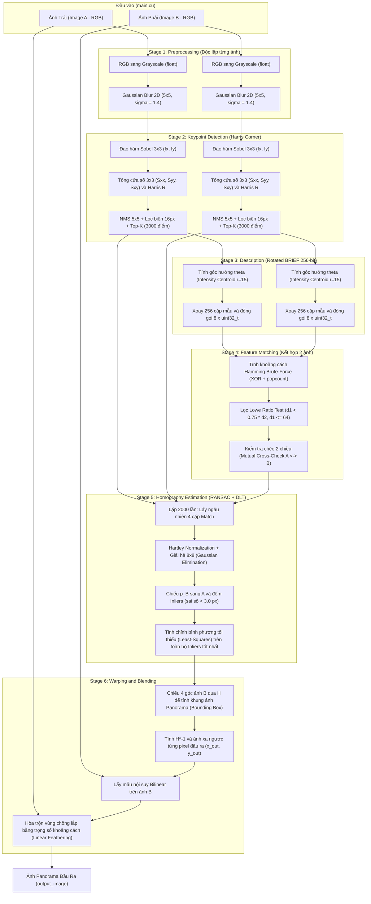
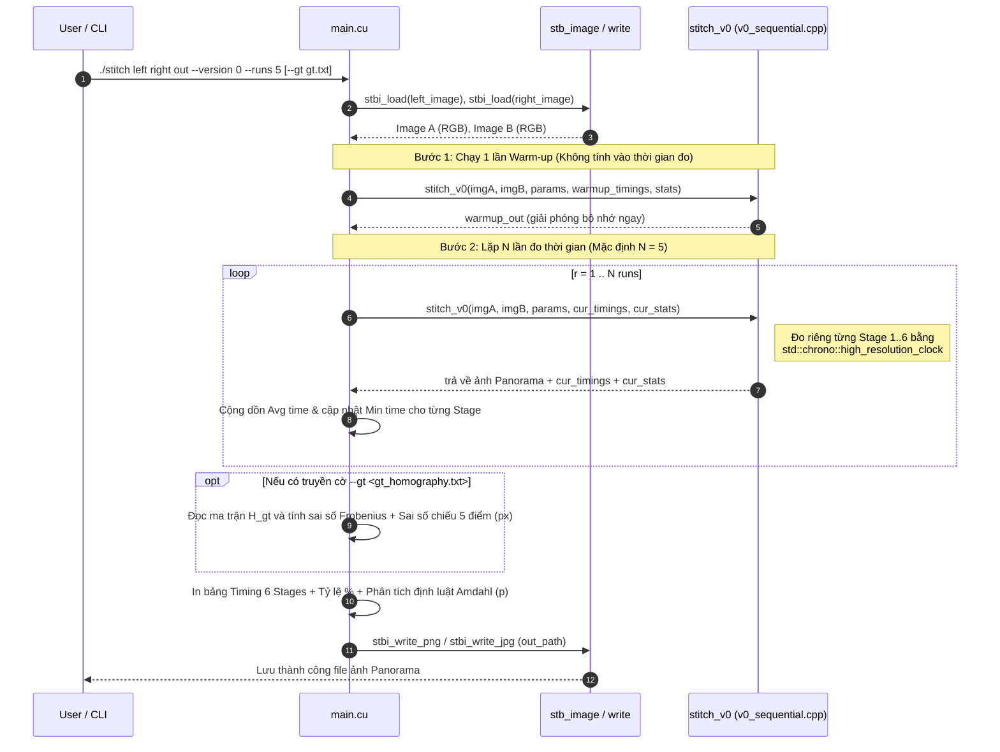

# Luồng Xử Lý Ghép Ảnh Panorama (`V0` Sequential Pipeline)

Tài liệu này mô tả chi tiết luồng xử lý của chương trình ghép ảnh Panorama (`stitch_v0` trong [v0_sequential.cpp](file:///home/iamhieu2012/Dev/image-stitching/src/v0_sequential.cpp)) bằng sơ đồ **Mermaid**.

---

## 1. Sơ Đồ Tổng Quan Pipeline (6 Stages)

Các bước **Stage 1 $\rightarrow$ Stage 3** xử lý hoàn toàn độc lập trên từng ảnh (`Image A` và `Image B`). Từ **Stage 4 $\rightarrow$ Stage 6**, dữ liệu của cả hai ảnh được kết hợp lại để tìm phép biến đổi hình học và tạo ra ảnh Panorama cuối cùng.

---

## 2. Sơ Đồ Chi Tiết Luồng Thực Thi & Đo Thời Gian (`main.cu` $\rightarrow$ `stitch_v0`)

Sơ đồ trình tự (Sequence Diagram) dưới đây thể hiện cách chương trình chính [`main.cu`](file:///home/iamhieu2012/Dev/image-stitching/src/main.cu) đọc ảnh, chạy **Warm-up**, lặp **$N$ lần đo thời gian**, kiểm tra sai số với Ground-Truth và lưu ảnh kết quả:

---

## 3. Sơ Đồ Chi Tiết Thuật Toán RANSAC + Normalized DLT (Stage 5)

Stage 5 là bước quyết định độ chính xác hình học của ảnh ghép. Luồng xử lý chi tiết bên trong hàm `estimate_homography_ransac` như sau:

```mermaid
flowchart LR
    Matches["Tập Matches từ Stage 4 (M cặp điểm)"] --> CheckM{"M >= 4?"}
    CheckM -- "Không" --> Identity["Trả về ma trận đơn vị I"]
    CheckM -- "Có" --> LoopStart["Vòng lặp RANSAC (iter = 1..2000)"]

    subgraph RansacLoop["Mỗi vòng lặp RANSAC"]
        LoopStart --> Pick4["Chọn ngẫu nhiên 4 cặp điểm phân biệt"]
        Pick4 --> Hartley["Chuẩn hóa Hartley: Dịch tâm về (0,0), co giãn khoảng cách TB = sqrt(2)"]
        Hartley --> Solve8x8["Lập hệ phương trình chuẩn 8x8 và giải Khử Gauss (Partial Pivoting)"]
        Solve8x8 --> Denorm["Khử chuẩn hóa: H = T_A^-1 * H_norm * T_B"]
        Denorm --> EvalInliers["Chiếu toàn bộ M điểm từ B sang A, đếm số điểm có sai số Euclid < 3.0 px"]
        EvalInliers --> UpdateBest["Cập nhật best_H nếu số Inliers lớn hơn (hoặc bằng nhưng tổng sai số nhỏ hơn)"]
    end

    UpdateBest --> RefineCheck{"best_inliers >= 4?"}
    RefineCheck -- "Có" --> LeastSquares["Gom tất cả Inliers tốt nhất -> Giải lại DLT Bình phương tối thiểu (A^T A h = A^T b)"]
    LeastSquares --> FinalH["Ma trận Homography tối ưu H (3x3)"]
    RefineCheck -- "Không" --> FinalH
```

---

## 4. Tóm Tắt Input / Output & Độ Phức Tạp Từng Stage

| Stage | Hàm trong `v0_sequential.cpp` | Input | Output | Độ phức tạp tuần tự |
| :--- | :--- | :--- | :--- | :--- |
| **1. Preprocessing** | `rgb_to_grayscale` `gaussian_blur_2d` | `Image A, B` ($W \times H \times 3$ `uint8_t`) | `blurA, blurB` ($W \times H$ `float`) | $O(W \cdot H \cdot k^2)$ với $k=5$ |
| **2. Keypoint Detection** | `detect_harris_keypoints` | `blurA, blurB` ($W \times H$ `float`) | `kpA, kpB` ($\le 3000$ `Keypoint`) | $O(W \cdot H + C \log K)$ |
| **3. Description** | `compute_rotated_brief_descriptors` | `blurA, blurB` + `kpA, kpB` | `descA, descB` ($\le 3000 \times 256\text{-bit}$) | $O(K \cdot (r^2 + 256))$ với $r=15$ |
| **4. Matching** | `match_descriptors` | `descA` ($N_A$), `descB` ($N_B$) | `matches` ($M$ cặp điểm khớp) | $O(N_A \cdot N_B)$ |
| **5. Homography** | `estimate_homography_ransac` `compute_normalized_dlt_homography` | `kpA, kpB, matches` | Ma trận `Homography H` ($3\times 3$) | $O(I_{\text{ransac}} \cdot (8^3 + M))$ |
| **6. Warping & Blending** | `warp_and_blend` | `imgA, imgB, H` | Ảnh Panorama `pano` ($W_{out} \times H_{out} \times 3$) | $O(W_{out} \cdot H_{out})$ |
